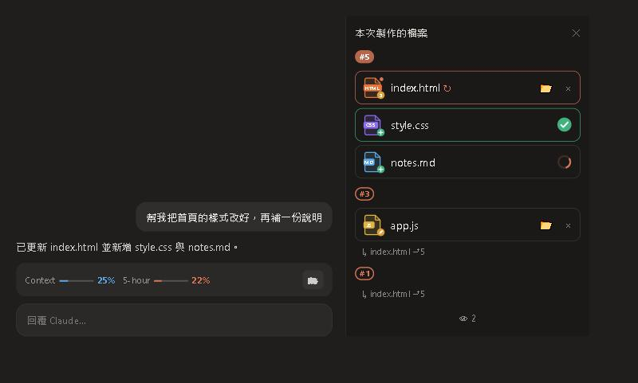

# 檔案面板 · Claude Code mods

在 Claude Code 右側加一個面板，列出這個對話**每一輪問答製作或修改了哪些檔案**，按一下就在檔案總管中顯示、選取那個檔案。



<sub>示意圖，實際外觀依 Claude Code 版本與主題略有不同。</sub>

## 包含兩個 mod

| mod | 做什麼 |
| --- | --- |
| **session-files** | 右側面板。依輪次分組（`#5` 是本輪，空心徽章是較早的輪），檔名旁的小徽章表示新建 ⊕ 或修改 ✎／次數。📂 在檔案總管中顯示並選取該檔案，× 隱藏。暫存檔、測試檔、log 等次要檔案自動隱藏，👁 可以展開。同一個檔案在較早的輪只顯示一行 `↳ 檔名 ⤴5`，指向最新那一輪。滑鼠移到圖示上可看完整路徑與那一輪的問題。 |
| **pane-launcher** | 輸入框上方、計量列右側的 🗂 小圖示，按一下開啟檔案面板（也會自動列出其他描述含「面板」的 mod）。 |

## 安裝

需要 Claude Code（終端機版或桌面版）。

**在 Claude Code 終端機的輸入框**輸入：

```
/plugin install session-files --marketplace lee851104/mods_file
/plugin install pane-launcher --marketplace lee851104/mods_file
```

第一次會問 `Add marketplace?`，按 `y`；範圍選 user（直接按 Enter）。

**或在一般命令列（shell）**：

```bash
claude plugin install session-files --marketplace lee851104/mods_file
claude plugin install pane-launcher --marketplace lee851104/mods_file
```

**桌面版 app**（`/plugin` 在那裡不能用）：點輸入框旁的 **+** → **Plugins** → **Add marketplace**，輸入 `lee851104/mods_file`，再分別加入 `session-files` 和 `pane-launcher`。在終端機以 user 範圍安裝的 mod，桌面版也會一起載入。

裝好後開新的對話就會出現；面板關掉後可以按 🗂 或輸入 `/session-files` 重新開啟。

## 更新

```bash
claude plugin marketplace update mods-file
claude plugin update session-files@mods-file
claude plugin update pane-launcher@mods-file
```

## 說明

- 「在檔案總管中顯示」在 **Windows** 上會開新的檔案總管視窗、選取檔案並帶到最前面；macOS 用 Finder（`open -R`），Linux 開啟所在資料夾。
- 只讀取這個對話的紀錄，不會上傳任何東西。
- 原始碼與測試在各 mod 的 `hooks/` 資料夾；`claude plugin test <mod 資料夾>` 可執行測試。
